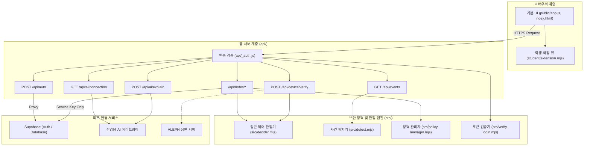

# ALEPH 방어전 학생 실행 설명서 및 시스템 구성도 (STUDENT_RUNBOOK)

이 문서는 제3자가 작업 위치와 명령어를 확인하여 프로젝트를 실행하고 아키텍처를 파악할 수 있도록 작성한 공식 실행 설명서입니다. 프로젝트의 실제 코드, 설정, 패키지 파일과 일치하며 일체의 비밀값(토큰, API 키, 비밀번호)을 포함하지 않습니다.

---

## 1. 실행 환경 및 프로그램 사양

본 프로젝트는 Windows 및 PowerShell 환경을 기준으로 검증되었습니다.

| 프로그램 / 런타임 | 요구 버전 | 실제 확인 버전 | 확인 명령어 | 비고 |
| :--- | :--- | :--- | :--- | :--- |
| **Node.js** | `>=22` (`package.json`) | `v24.22.1` | `node -v` | ESM 모듈(`type: "module"`) 및 네이티브 테스트 러너(`node --test`) 사용 |
| **npm** | 최신 권장 | `11.19.1` | `npm -v` | 패키지 의존성 관리 및 빌드/테스트 스크립트 실행 |
| **Git** | `2.x` 이상 | `2.55.0.windows.5` | `git --version` | 형상 관리 및 제출 커밋 해시 추적 |
| **PowerShell** | `5.1` 또는 `7.x` | Windows PowerShell | `$PSVersionTable.PSVersion` | 기본 셸 환경 |
| **Web Browser** | 최신 Chromium / Gecko | 최신 Chrome / Edge | - | DOM 렌더링 및 UI 검증 |

---

## 2. 프로젝트 폴더 구조 및 역할

작업의 Git 최상위 폴더(`C:\work\aleph-defense`) 기준 디렉터리 구성입니다.

```
aleph-defense/
├── api/                      # Vercel 서버리스 API 엔드포인트 계층 (제공 코드 및 서버 통신)
│   ├── _auth.js              # 인증 검증 및 환경변수 접근 공통 모듈
│   ├── auth.js               # 로그인/세션 발급 엔드포인트 (POST /api/auth)
│   ├── events.js             # 보안 이벤트 조회 (GET /api/events)
│   ├── ai/                   # AI 게이트웨이 프록시 (connection.js, explain.js)
│   ├── device/               # 기기 검증 엔드포인트 (verify.js)
│   ├── notes/                # 가상 메모 CRUD 및 복구 엔드포인트 (index.js, [id].js, restore.js)
│   ├── notices/              # 공지사항 조회 엔드포인트 (index.js, [id].js)
│   └── ops/                  # 운영 요약 조회 (summary.js)
├── docs/                     # 시스템 문서
│   ├── DECIDER_REQUEST.md    # 6~8단계 접근 제어 판정기 계약 명세 (제공 문서)
│   ├── DETECT_EVENTS.md      # 9~10단계 이상 탐지 엔진 사건 규격 (제공 문서)
│   └── STUDENT_RUNBOOK.md    # [본 문서] 21단계 학생용 실행 설명서 및 시스템 구성도
├── public/                   # 정적 웹 자원 계층 (제공 UI)
│   ├── app.js                # 웹 애플리케이션 진입점 및 백엔드 연동 클라이언트 (제공 코드)
│   ├── index.html            # 브라우저 UI 마크업
│   └── aleph.json            # 배포 메타데이터 (빌드 시 생성)
├── scripts/                  # 빌드, 검증, 번들링 및 복구 스크립트
│   ├── build-public.mjs      # 정적 빌드 스크립트 (`npm run build`)
│   ├── bundle.mjs            # 단계별 검증 및 제출 묶음 생성 (`npm run bundle`)
│   ├── decider-test.mjs      # 판정기 로컬 검증 (`npm run decider:test`)
│   ├── detect-test.mjs       # 탐지기 로컬 검증 (`npm run detect:test`)
│   ├── fixture-7.mjs         # 복합 이상 접속 검증 (`npm run fixture:7`)
│   ├── policy-diff.mjs       # 보안 정책 차이 대조 (`npm run policy:diff`)
│   └── policy-restore.mjs    # 보안 정책 안전 복원 (`npm run policy:restore`)
├── src/                      # 핵심 비즈니스 로직 및 정책 엔진 (학생/공통 구현)
│   ├── decider.mjs           # 제로 트러스트 접근 제어 판정기 (`decide`)
│   ├── detect.mjs            # 이상 접속 및 폭주 조회 탐지기 (`detectEvents`)
│   ├── policy-manager.mjs    # 보안 정책 무결성 검증 및 복원
│   ├── verify-login.mjs      # JWT 서명/만료/대상 검증
│   ├── policy-active.json    # 현재 활성 정책 파일
│   └── policy-backup.json    # 안전 기준 백업 정책 파일
├── student/                  # 학생 확장 UI 렌더링 계층
│   └── extension.mjs         # 상태 표시, AI 설명, 조치, 취약점 렌더러 구현 모듈
├── test/                     # 단위 및 통합 테스트 스위트
│   ├── action.test.mjs       # 19단계 조치 분리 및 실측 검증
│   ├── ai-connection.test.mjs# 17단계 AI 연결 및 설명 검증
│   ├── build-identity.test.mjs# 배포 식별자 검증
│   ├── explanation.test.mjs  # 18단계 근거 기반 설명 검증
│   ├── restore.test.mjs      # 11단계 메모 및 정책 복구 검증
│   ├── student-events.test.mjs# 15단계 이벤트 목록 및 상세 검증
│   ├── student-status.test.mjs# 14단계 기기/세션/진단 상태 검증
│   └── vulnerabilities.test.mjs# 20단계 취약점 및 OSV 매핑 검증
├── aleph.config.json         # 과제 단계 설정 및 허용 엔드포인트 명세
├── package.json              # 패키지 명세 및 스크립트 정의
└── package-lock.json         # 의존성 고정 락 파일
```

---

## 3. 작업 위치 및 실행 명령어

### 3.1 PowerShell 실행 위치
반드시 Git 저장소의 최상위 디렉터리에서 PowerShell을 실행합니다:
```powershell
Set-Location -Path "C:\work\aleph-defense"
```

### 3.2 의존성 설치
```powershell
npm install
```
*설치 패키지 버전 고정*:
- `@supabase/supabase-js`: `2.117.2`
- `jose`: `6.2.12`

### 3.3 로컬 정적 빌드
```powershell
npm run build -- --local
```
- **정상 시작/완료 신호**: 콘솔에 에러 없이 프로세스가 종료되며 `public/` 디렉터리에 필요 자원이 준비됨.

### 3.4 전체 테스트 스위트 검증 (65종 단위 테스트)
```powershell
npm run test:r5
```
- **정상 확인 신호**:
  ```text
  ℹ tests 65
  ℹ pass 65
  ℹ fail 0
  ```

### 3.5 보안 엔진 및 정책 스크립트 검증
```powershell
# 접근 제어 판정기 가상 요청 시험 (9개 시나리오 통과 확인)
npm run decider:test

# 비정상 행위 및 폭주 조회 탐지기 가상 시험 (6개 시나리오 통과 확인)
npm run detect:test

# 복합 이상 접속 판정 픽스처 시험 (정상: allow, 복합 이상: step_up 확인)
npm run fixture:7

# 보안 정책 변조 차이 대조
npm run policy:diff

# 안전 기준 정책 복원
npm run policy:restore
```

### 3.6 자기 점검 번들 생성
```powershell
npm run bundle
```
- **정상 시작/완료 신호**:
  ```text
  제출 묶음 JSON 생성: C:\work\aleph-defense\artifacts\submission.json
  단계 12 · 커밋 ... · 바뀐 파일 ... · 규칙 3개 · 직접 점검 17개
  ```

### 3.7 종료 및 재실행 순서
- **종료**: 실행 중인 CLI 프로세스나 서버는 터미널에서 `Ctrl + C`를 누르고 필요 시 `Y`를 입력하여 안전하게 종료합니다.
- **재실행**: 코드 또는 설정을 수정한 후 `npm run test:r5`를 실행하여 기존 65개 기능의 비회귀(Non-regression) 상태를 먼저 확인한 뒤 배포 및 테스트 절차를 수행합니다.

---

## 4. 접속 주소 및 환경

| 구분 | 접속 주소 (URL) | 설명 |
| :--- | :--- | :--- |
| **로컬 환경** | `http://localhost:3000` | 로컬 개발 서버 구동 시 접근 주소 |
| **공개 배포 앱** | `https://choi-bujang-secret-vault-evun.vercel.app` | Vercel 프로덕션 배포 주소 (`aleph.config.json`의 `publicAppUrl`) |
| **심판 접수 서버** | `https://aleph-judge-production.up.railway.app/defense/judge` | 심판 접수 서버 (`aleph.config.json`의 `judgeIssuer`) |
| **원격 인증 발급자**| `https://lokymnrpfrnfirmhjvht.supabase.co/auth/v1` | Supabase Auth JWT 발급자 (`aleph.config.json`의 `identityProvider.issuer`) |

---

## 5. 시스템 아키텍처 및 데이터 흐름

### 5.1 아키텍처 개요
시스템은 사용자 브라우저, 로컬 앱 서버(Vercel Serverless Function 프록시), 보안 제어 및 판정 엔진, 외부 시스템(인증/DB 및 심판/AI 게이트웨이)의 4계층으로 구성됩니다.
1. **브라우저 계층**: 제공된 기본 UI(`public/app.js`)와 학생 확장 UI(`student/extension.mjs`)가 DOM을 생성하고 사용자의 조작을 처리합니다. 브라우저는 외부 데이터베이스나 기밀 키에 직접 접근하지 않습니다.
2. **앱 서버 계층 (`api/`)**: 모든 클라이언트 요청을 중앙 집중식으로 프록시하며, JWT 토큰 서명/만료/대상을 검증(`api/_auth.js`)한 후 인가된 요청만 백엔드로 전달합니다.
3. **접근 제어 및 보안 엔진 (`src/`)**: 제로 트러스트 판정기(`src/decider.mjs`), 비정상 탐지기(`src/detect.mjs`), 정책 관리자(`src/policy-manager.mjs`)가 기기 상태, 신호 출처, 네트워크 구역을 검증합니다.
4. **외부 연동 계층**: Supabase REST API(서버 키를 통해서만 접근), ALEPH 심판 엔진, AI 게이트웨이로 구성됩니다.

### 5.2 텍스트 기반 구성도 (ASCII)
```
+-----------------------------------------------------------------------------------------+
|                                    1. 사용자 브라우저                                    |
|   +---------------------------------------+   +-------------------------------------+   |
|   |         public/index.html             |   |       student/extension.mjs         |   |
|   |         public/app.js                 |   |  - renderStatus, renderEvents       |   |
|   |  - 화면 제어 및 사용자 입력 처리      |   |  - renderAiConnection, renderAction |   |
|   |  - 백엔드 API 비동기 fetch 호출       |   |  - renderVulnerabilities            |   |
|   +---------------------------------------+   +-------------------------------------+   |
+--------------------------------------------+--------------------------------------------+
                                             |
                                             | HTTPS / JSON (Bearer Token)
                                             v
+-----------------------------------------------------------------------------------------+
|                                 2. 로컬 앱 서버 (Vercel API)                             |
|   +---------------------------------------------------------------------------------+   |
|   |                                  api/_auth.js                                   |   |
|   |   - Bearer 토큰 추출, src/verify-login.mjs 연동 서명/만료/대상 검증            |   |
|   +---------------------------------------------------------------------------------+   |
|   |  엔드포인트 라우팅:                                                             |   |
|   |  - POST /api/auth               -> api/auth.js (로그인 프록시)                  |   |
|   |  - POST /api/device/verify      -> api/device/verify.js (기기 등록 확인)        |   |
|   |  - GET/PUT/DELETE /api/notes/*  -> api/notes/ (소유자 격리 및 CRUD)             |   |
|   |  - POST /api/notes/restore      -> api/notes/restore.js (단건 사본 복구)        |   |
|   |  - GET /api/notices/*           -> api/notices/ (공지사항 읽기 전용)            |   |
|   |  - GET /api/events              -> api/events.js (보안 사건 기록 조회)          |   |
|   |  - GET /api/ai/connection       -> api/ai/connection.js (AI 연결 점검)          |   |
|   |  - POST /api/ai/explain         -> api/ai/explain.js (보안 사건 AI 설명)        |   |
|   +---------------------------------------------------------------------------------+   |
+---------------------+----------------------------------------------------+--------------+
                      |                                                    |
                      v                                                    v
+---------------------------------------+          +--------------------------------------+
|     3. 접근 제어 · XDR 시스템 (src/)  |          |           4. AI 게이트웨이           |
|  +---------------------------------+  |          |  +--------------------------------+  |
|  | src/decider.mjs (`decide`)      |  |          |  | 외부 AI 프록시 연동            |  |
|  | - 기기 등록(`deviceRegistered`) |  |          |  | - 권한 검증(audienceAuth)      |  |
|  | - 복합 이상 탐지(`stepUp`)      |  |          |  | - 모델 목록 조회               |  |
|  | - 구역 정책(`zone_policy`)      |  |          |  | - 지연 응답 무효화 처리        |  |
|  +---------------------------------+  |          |  +--------------------------------+  |
|  | src/detect.mjs (`detectEvents`) |  |          +--------------------------------------+
|  | - 폭주 조회 및 슬라이딩 윈도우  |  |                                  ^
|  +---------------------------------+  |                                  |
|  | src/policy-manager.mjs          |  |                                  |
|  | - 정책 무결성 검사 및 안전 복원 |  |                                  |
|  +---------------------------------+  |                                  |
+---------------------+-----------------+                                  |
                      |                                                    |
                      v (HTTPS / Rest API)                                 |
+-------------------------------------------------------+                  |
|                   5. 외부 데이터베이스                |                  |
|   Supabase Storage / Database (notes, notices)        |                  |
|   - RLS(Row Level Security) 적용 및 직접 접근 차단    |------------------+
+-------------------------------------------------------+
```

### 5.3 Mermaid 구성도


### 5.4 계층별 모듈 및 데이터 흐름 표
| 계층 | 대상 모듈/파일 | 입력 데이터 | 처리 내용 | 출력/결과 |
| :--- | :--- | :--- | :--- | :--- |
| **브라우저** | `student/extension.mjs`<br>`public/app.js` | 사용자 클릭, 서버 응답 JSON | DOM 생성(`createElement`), 상태별 분기 렌더링, `data-*` 속성 바인딩 | 화면 갱신, 식별자 보존 |
| **앱 서버** | `api/_auth.js`<br>`api/notes/index.js` | HTTP 요청, `Authorization: Bearer <jwt>` | JWT 검증(`verify-login.mjs`), 소유자 ID 대조, RLS 격리 | `200 OK` (데이터) 또는 `401`/`403` JSON 거부 |
| **보안 판정** | `src/decider.mjs` | `DECIDER_REQUEST` 규격 JSON | 기기 등록 여부, 복합 이상 신호 출처, 구역별 허용 메서드 판정 | `allow`, `deny`, `step_up` 결정 및 사유코드 |
| **이상 탐지** | `src/detect.mjs` | 감사 로그 사건 배열 | 10분 슬라이딩 윈도우 기준 요청 빈도 및 폭주 조회 검출 | 발생 사건 ID 및 위험 경보 객체 |
| **AI 게이트웨이** | `api/ai/*.js` | 점검 요청, 사건 근거 ID 목록 | 외부 AI 연결 상태 실측, 근거 바인딩 기반 요약 생성 | 연결 상태 코드, AI 설명 요약문 |

---

## 6. 기능 경계 및 검증 상태 구분 표

### 6.1 제공 코드 vs 학생 구현 경계
| 구분 | 제공 코드 (수정 금지) | 학생 구현 함수/파일 |
| :--- | :--- | :--- |
| **UI 계층** | `public/index.html`<br>`public/app.js` | `student/extension.mjs`<br>- `createStudentView`<br>- `renderStatus`<br>- `renderEvents`<br>- `renderAiConnection`<br>- `renderExplanation`<br>- `renderAction`<br>- `renderVulnerabilities` |
| **API 계층** | `api/auth.js`, `api/events.js`<br>`api/device/verify.js`<br>`api/ops/summary.js`<br>`api/notices/` | `api/_auth.js` (인가 보완)<br>`api/notes/restore.js` (사본 복구)<br>`src/verify-login.mjs` (토큰 검증) |
| **정책/엔진**| `scripts/bundle.mjs`<br>`docs/DECIDER_REQUEST.md`<br>`docs/DETECT_EVENTS.md` | `src/decider.mjs` (`decide`)<br>`src/detect.mjs` (`detectEvents`)<br>`src/policy-manager.mjs` (`verifyBackupPolicy`, `getPolicyDiff`, `restorePolicy`) |

### 6.2 실측 완료 기능 (테스트 통과)
| 검증 대상 | 실행 스크립트 | 통과 항목 수 | 실측 내용 요약 |
| :--- | :--- | :--- | :--- |
| **단위 테스트 스위트** | `npm run test:r5` | 65 / 65 통과 | - 13~14단계: 기기/세션 상태 분리 및 민감정보 제거<br>- 15단계: 접속 기록/경보 목록, 계약 불일치 처리<br>- 16단계: 정책 복원 및 비공개 메모 복구<br>- 17단계: AI 연결 점검 상태 4단계 및 7대 에러 대응<br>- 18단계: 근거 바인딩 AI 설명 및 지연 응답 무효화<br>- 19단계: 조치 상태/실제 효과 분리 (`effectApplied`)<br>- 20단계: 설치 패키지 락 버전 매핑 및 OSV 취약점 분기 |
| **접근 제어 판정기** | `npm run decider:test` | 9 / 9 통과 | 등록 기기 허용, 미등록 거부, 복합 이상 접속 step_up, 공지사항 읽기 전용 구역 제어 |
| **이상 탐지기** | `npm run detect:test` | 6 / 6 통과 | 10분 내 120건 정상, 121건 이상 탐지, 폭주 조회 차단 |
| **복합 이상 픽스처** | `npm run fixture:7` | 통과 | 정상 사건 `allow`, 복합 이상 사건 `step_up` 판정 |
| **정책 차이 대조** | `npm run policy:diff` | 통과 | 5개 변조 항목(버전, 소유자 격리, 공지 쓰기 권한) 식별 |
| **로컬 정적 빌드** | `npm run build -- --local` | 정상 완료 | `public/data.json` 제거 및 정적 배포 구조 생성 |

### 6.3 미확인 및 시뮬레이션 항목 (과정 외 범위 명시)
본 프로젝트는 판정 환경 및 모의 픽스처를 기준으로 구현 및 검증되었으며, 다음 항목은 실제 상용 인프라가 연동되지 않았음을 명시합니다:
1. **실제 ALEPH 운영 심판 실시간 통신**: `npm run bundle` 및 로컬 테스트는 가상 픽스처 기반 자기 점검이며, 외부 심판 서버와의 실시간 라이브 채점 세션은 포함되지 않음.
2. **사내망 실서버 mTLS 개인 인증서 연동**: 실제 기업 제로 트러스트 게이트웨이 접속 시 요구되는 개인 인증서는 학원 환경 정책상 발급되지 않으므로, 앱은 모의 환경('서버 연결 안 함' 또는 모의 응답)으로 동작함.
3. **상용 유료 LLM 외부 직접 호출**: 실제 유료 OpenAI/Anthropic/Gemini API 키를 외부 서버로 직접 전송하지 않으며, 수업용 AI 게이트웨이 모의 규격 및 정제된 에러 핸들링으로 검증됨.

---

## 7. 오류별 확인 및 조치 순서

| 발생 상황 / 에러 코드 | 원인 분석 | 확인 및 조치 순서 |
| :--- | :--- | :--- |
| **`401 Unauthorized`** | 미인증 또는 위조/만료된 JWT 토큰 전송 | 1. `Authorization: Bearer <token>` 헤더 누락 여부 확인<br>2. Supabase Auth 로그인 세션 만료 확인 및 재로그인 수행<br>3. `api/_auth.js` 및 `src/verify-login.mjs`의 JWKS 서명 검증 로직 확인 |
| **`403 Forbidden`** | 타인 소유 자원 접근(IDOR) 또는 미승인 기기 | 1. 요청 사용자의 `userId`와 대상 자원의 `owner_id` 일치 여부 대조<br>2. 기기 등록 여부(`request.deviceRegistered === true`) 확인<br>3. `src/decider.mjs`의 구역 정책 규칙 대조 |
| **`CONTRACT_MISMATCH`** | API 응답 규격이 예상 인터페이스와 불일치 | 1. 반환된 JSON의 필수 속성 누락 확인<br>2. 화면에 표시된 에러 메시지 확인 후 API 버전 호환성 점검 |
| **`AUTH_PENDING` / AI 에러** | AI 게이트웨이 권한 준비 중 또는 인증 실패 | 1. 고정 verified가 아닌지 확인<br>2. 게이트웨이 권한 및 7대 사유 코드 확인<br>3. 자동 재시도 없이 화면의 「다시 점검」 버튼을 수동으로 눌러 재시도 |
| **`effectApplied === false`** | 보안 조치 접수(ACK) 후 실제 효과 미반영 | 1. 조치 접수(`pending`)와 실제 관측 효과(`succeeded`)를 오인하지 않았는지 확인<br>2. `observation.effectApplied`가 `true`가 될 때까지 결과를 재조회 |
| **`lookup_unavailable` / OSV** | 인터넷 단절 또는 OSV 서비스 미설정 | 1. 패키지 버전 자체는 `package-lock.json`의 고정 버전으로 정상 표기되는지 확인<br>2. OSV 조회가 불가능한 상태를 '취약점 없음'으로 왜곡하지 않고 '확인 불가'로 유지 |
